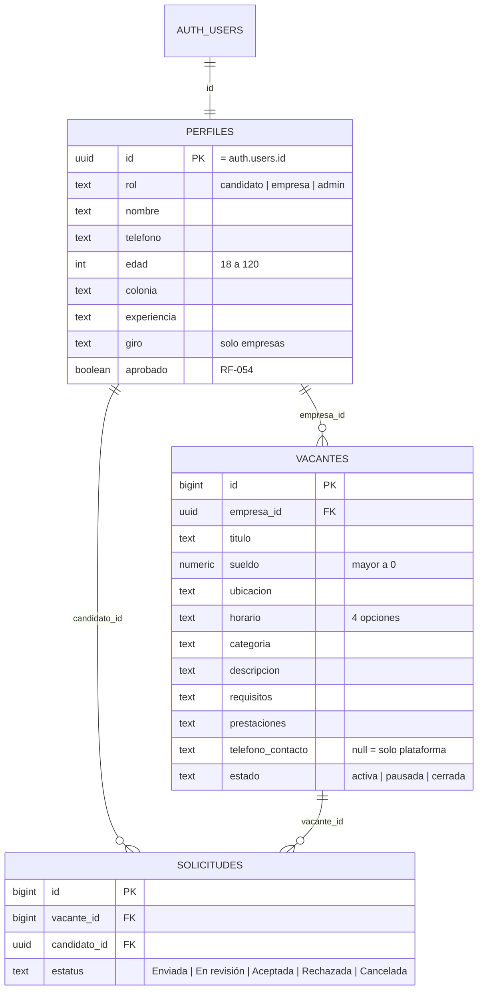

# AMAC · Plataforma de empleo para personas adultas mayores

Proyecto final OT2026-WEB · **Entrega 3: React + Supabase + Vercel**

- **Aplicación publicada:** https://amac-web2.vercel.app
- **Repositorio:** https://github.com/dienunez162-afk/amac-web2
- **Video de la presentación:** https://drive.google.com/drive/folders/1xQrQZuDfPjZ8vY_sx0-8kSExnVeSfBVy?usp=sharing
- **Diapositivas:** _(agregar enlace o PDF)_

AMAC conecta a personas adultas mayores que buscan empleo con empresas que quieren contratarlas. El candidato busca vacantes, se postula y sigue el estatus de sus solicitudes; la empresa publica vacantes y gestiona a sus prospectos; AMAC aprueba a los candidatos antes de que puedan postularse.

---

## Integrantes y qué hizo cada uno

| Integrante | Responsabilidad en la Entrega 3 | Archivos principales |
|---|---|---|
| **Diego Núñez** | Proyecto React (Vite, rutas, estructura), base de datos en Supabase (tablas, trigger, políticas RLS) y **flujo del candidato**: listado con búsqueda y filtros, detalle de vacante, postularse y mis solicitudes | `src/App.jsx`, `src/lib/`, `src/context/AuthContext.jsx`, `supabase/esquema.sql`, `src/pages/ListadoVacantes.jsx`, `DetalleVacante.jsx`, `MisSolicitudes.jsx`, `src/components/BotonPostular.jsx` |
| **Ricardo Villarreal** | **Cuentas y despliegue**: registro de candidato y de empresa, inicio y cierre de sesión, rutas protegidas por rol, publicación en Vercel con variables de entorno y configuración de Supabase Auth | `src/pages/Login.jsx`, `RegistroCandidato.jsx`, `RegistroEmpresa.jsx`, `src/components/RutaProtegida.jsx`, `Encabezado.jsx`, `vercel.json` |
| **Emiliano** | **Diseño y flujo de la empresa**: estilos según el prototipo de Figma, componentes visuales reutilizables, accesibilidad (Lighthouse) y páginas de empresa: publicar vacante, mis vacantes y solicitudes recibidas | `src/styles/`, `src/components/Icono.jsx`, `TarjetaVacante.jsx`, `Prospecto.jsx`, `Campo.jsx`, `src/pages/PublicarVacante.jsx`, `EmpresaVacantes.jsx`, `SolicitudesRecibidas.jsx` |

---

## Tecnologías

- **React 19** con **Vite** (SPA) y **React Router 7** (rutas y rutas protegidas)
- **Supabase**: PostgreSQL, Auth (correo y contraseña), API automática y **Row Level Security**
- **Vercel**: hosting con HTTPS y despliegue continuo desde GitHub
- CSS propio (sin frameworks), fuente Work Sans

## Cómo correr el proyecto localmente

Requisito: Node.js 20 o superior.

```bash
git clone https://github.com/dienunez162-afk/amac-web2
cd amac-web2
npm install
```

Crear el archivo **`.env.local`** en la raíz (copiar `.env.example`) con los datos de *Supabase → Project Settings → API Keys*:

```
VITE_SUPABASE_URL=https://xxxxxxxx.supabase.co
VITE_SUPABASE_PUBLISHABLE_KEY=sb_publishable_xxxxxxxx
```

```bash
npm run dev      # abre http://localhost:5173
npm run build    # versión de producción en dist/
```

> `.env.local` está en `.gitignore` y nunca se sube. En React solo se usa la *publishable key*; la *secret key* no aparece en ninguna parte del código.

## Cuentas de prueba

| Rol | Correo | Contraseña | Notas |
|---|---|---|---|
| Candidato **aprobado** | `candidato.aprobado@amac.test` | `Prueba-3270509455` | José Hernández · puede postularse |
| Candidato **sin aprobar** | `candidato.pendiente@amac.test` | `Prueba-1236341158` | Rosa Martínez · al postularse lo bloquea RLS |
| Empresa | `empresa.demo@amac.test` | `Prueba-3146756089` | Restaurante La Abuela · tiene vacantes y solicitudes |

La aprobación de candidatos (RF-054) la hace el equipo de AMAC en *Supabase → Table Editor → perfiles*, cambiando `aprobado` a `true`.

---

## Estructura del proyecto

```
src/
├── main.jsx                 punto de entrada: BrowserRouter + AuthProvider
├── App.jsx                  definición de rutas
├── lib/                     cliente de Supabase, formatos, validaciones y catálogos
├── context/AuthContext.jsx  sesión y perfil (rol, aprobado) para toda la app
├── components/              Encabezado, Pie, RutaProtegida, TarjetaVacante, EncabezadoEmpresa,
│                            DatosVacante, EtiquetaEstatus, BotonPostular, Prospecto, Campo,
│                            Mensaje, VentanaConfirmacion, Icono
├── pages/                   ListadoVacantes, DetalleVacante, Login, RegistroCandidato,
│                            RegistroEmpresa, MisSolicitudes, EmpresaVacantes,
│                            PublicarVacante, SolicitudesRecibidas, NoEncontrada
└── styles/                  variables, base, layout y componentes (CSS)
supabase/
├── esquema.sql              SQL final usado en Supabase
└── cargar-datos-prueba.mjs  carga 1 empresa y 6 vacantes de ejemplo (usa solo la publishable key)
```

| Ruta | Página | Acceso |
|---|---|---|
| `/` | Listado de vacantes | Público |
| `/vacantes/:id` | Detalle de vacante | Público |
| `/login`, `/registro`, `/registro-empresa` | Sesión y registro | Público |
| `/mis-solicitudes` | Mis solicitudes | Solo candidatos |
| `/empresa/vacantes`, `/empresa/publicar`, `/empresa/vacantes/:id/solicitudes` | Panel de empresa | Solo empresas |

---

## Base de datos

Script completo: [`supabase/esquema.sql`](supabase/esquema.sql)

<!-- Agregar aquí la captura de Supabase → Database → Schema Visualizer:  -->



- **`unique (vacante_id, candidato_id)`** impide que un candidato se postule dos veces a la misma vacante (RF-004).
- El **trigger `crear_perfil`** crea la fila en `perfiles` cuando alguien se registra, con los datos de `options.data` de `signUp`.
- Las contraseñas las maneja **solo Supabase Auth**; ninguna tabla propia guarda contraseñas.

### Políticas de seguridad por fila (RLS)

RLS está activado en las tres tablas. Las rutas protegidas de React solo esconden pantallas; **la seguridad real está en estas políticas**, que PostgreSQL aplica aunque alguien manipule el navegador.

| Tabla | Política | Qué permite |
|---|---|---|
| perfiles | Cada quien ve su perfil | Leer solo tu propia fila |
| perfiles | Todos ven los perfiles de empresas | Mostrar el nombre de la empresa en las vacantes |
| perfiles | La empresa ve a quien aplicó a sus vacantes | La empresa solo ve candidatos que se postularon con ella |
| perfiles | Cada quien edita su perfil | Editar tu fila; con `grant` por columnas **nadie puede cambiarse `rol` ni `aprobado`** |
| vacantes | Ver vacantes activas o las propias | El público ve solo activas; la empresa ve también sus pausadas/cerradas |
| vacantes | El candidato sigue viendo las vacantes a las que aplicó | Aunque se pausen (RF-021) |
| vacantes | Solo empresas publican, a su nombre | `insert` solo si el rol es empresa y `empresa_id` es el usuario |
| vacantes | La empresa edita sus vacantes | Pausar / reactivar / cerrar solo las propias |
| solicitudes | Candidato ve las suyas; empresa ve las de sus vacantes | Nadie ve solicitudes ajenas |
| solicitudes | Solo candidatos aprobados se postulan | `insert` solo si `aprobado = true` (RF-054) |
| solicitudes | Candidato cancela si no está resuelta | Solo de Enviada/En revisión a Cancelada (RF-006) |
| solicitudes | Empresa cambia el estatus | Solo a En revisión / Aceptada / Rechazada, y solo en sus vacantes (RF-024) |

---

## Requerimientos implementados

| RF | Descripción | Estado |
|---|---|---|
| RF-001 | Listado de vacantes activas desde la BD | ✅ |
| RF-002 | Filtros por horario y categoría | ✅ |
| RF-003 | Detalle de vacante | ✅ |
| RF-004 | Postularse sin duplicados, con confirmación | ✅ |
| RF-005 | Mis solicitudes (fecha, vacante, empresa, estatus) | ✅ |
| RF-006 | Cancelar solicitud con confirmación (no Aceptada/Rechazada) | ✅ |
| RF-007 | Búsqueda por título o ubicación sin distinguir mayúsculas | ✅ |
| RF-008 | Inicio de sesión con mensaje de error genérico | ✅ |
| RF-009 | Cierre de sesión | ✅ |
| RF-010 | Rutas y datos protegidos por rol (RutaProtegida + RLS) | ✅ |
| RF-011 a RF-013 | Registro de candidato con validaciones y términos obligatorios | ✅ |
| RF-015 | Registro de empresa (versión simplificada) | ✅ |
| RF-019 | Publicar vacante con validaciones; teléfono solo si aplica | ✅ |
| RF-020 | Mis vacantes con número de solicitudes | ✅ |
| RF-021 | Pausar / reactivar / cerrar vacante | ✅ |
| RF-022 | Solicitudes recibidas con datos del candidato | ✅ |
| RF-024 | Cambiar estatus de la solicitud | ✅ |
| RF-024 | Fecha de cambio de estatus (opcional) | ❌ |
| RF-030 | Confirmación de correo | 🟡 desactivada para la demo |
| RF-051 | Botón "Llamar" solo si hay teléfono | ✅ |
| RF-054 | Solo candidatos aprobados se postulan (aprobación en Table Editor) | ✅ |
| RF-014 / RF-017 | Editar perfil (opcional) | ❌ |
| RF-016 | Logo de empresa con Storage (opcional) | ❌ |
| RF-029 | Recuperar contraseña (opcional) | ❌ |
| RF-041 | Vacantes favoritas (opcional) | ❌ |
| RF-055 | Proceso de selección por etapas (opcional) | ❌ |

## Accesibilidad y responsivo

- Texto base de 18 px, foco visible en todos los controles, enlace "Saltar al contenido".
- Cada campo con su `<label>`; errores unidos con `aria-describedby` y el foco va al primer error.
- Avisos con `role="alert"` / `role="status"`; ventanas con `role="dialog"` y cierre con Escape.
- Contraste revisado (los botones naranjas usan texto blanco grande).
- Diseño de 320 a 1440 px: barra de navegación abajo en celular, en el encabezado en escritorio.
- Lighthouse (Accesibilidad): _(agregar captura y puntaje)_

## Despliegue

Vercel construye el proyecto con `npm run build` y publica la carpeta `dist/`. Las variables `VITE_SUPABASE_URL` y `VITE_SUPABASE_PUBLISHABLE_KEY` están configuradas en Vercel. Cada `git push` a la rama de producción publica una nueva versión con HTTPS, y `vercel.json` redirige todas las rutas a `index.html` para que recargar `/mis-solicitudes` funcione.

La versión anterior (Entrega 2, HTML y CSS) se conserva en la carpeta [`entrega-2/`](entrega-2/).
